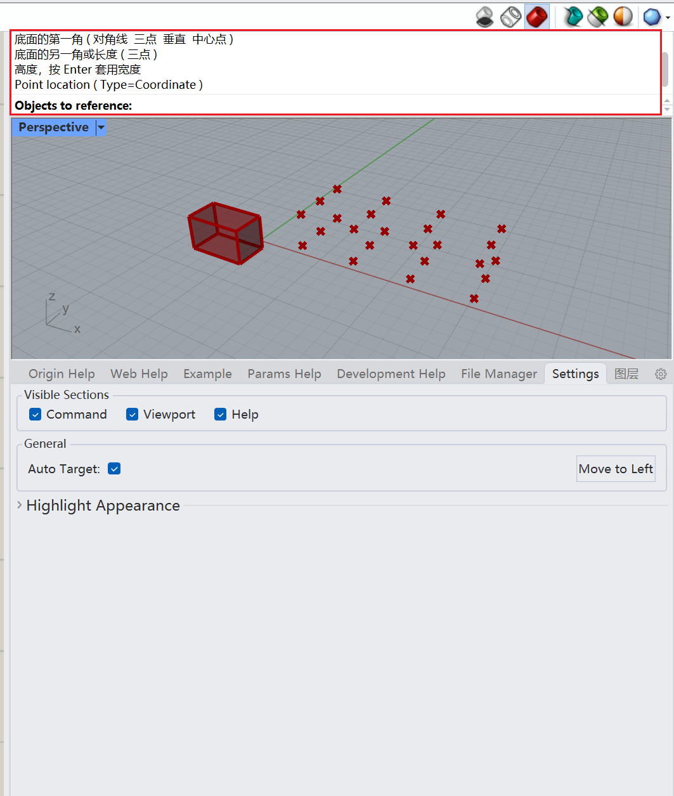
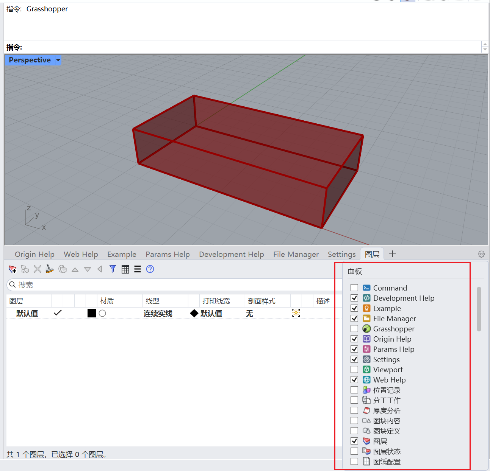
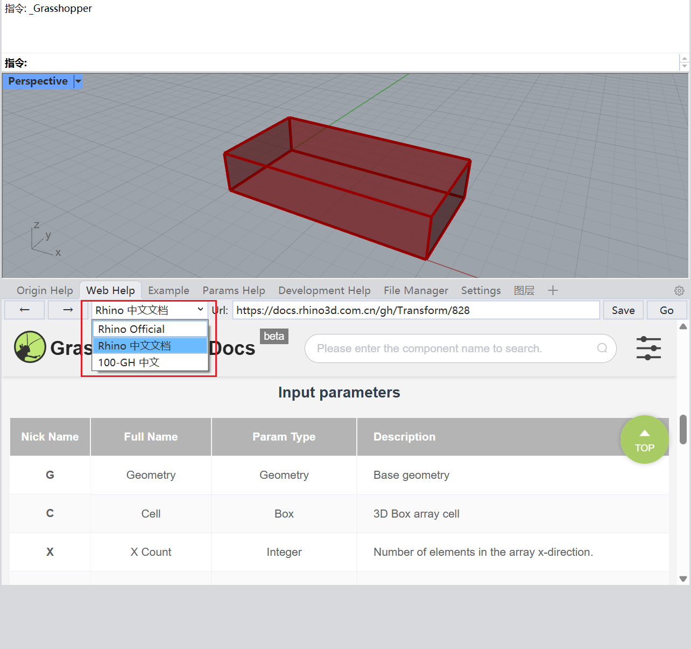

# SuperHelper🦗

> Much better helper control for grasshopper!

## What it is

Super Helper can make you learn Grasshopper easier, use Grasshopper faster, develop Grasshopper plugin easier.

See the [Quick start](quickstart.md) guide for more details.

## Features

- For Beginner
	- Browse the web by every document object to learn it.
	- Download the example from the Internet easily.

- For worker
	- Rhino view port on the Grasshopper.
	- Watching the data in Parameter easier.

- For developer
	- Find the assembly which contains the specific document object easily.
	- Find the inheritance relationship easily.

此版本已升级至 .NET 10，并适配 Rhino 9。

## R9版本新功能介绍

### 新增Command栏

支持直接在gh视口输入命令和收到命令反馈。

另外在打开边栏时setGH对象会屏蔽默认的最小化gh窗口操作

### 更自由的Panel

Panel栏支持Rhino面板嵌入

### Web Help 改进

内置了web官方源以及中文官方文档映射

